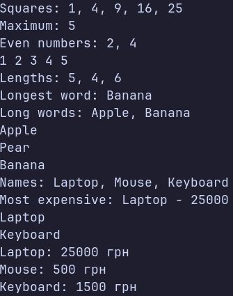

### Відповіді на питання

**1. Чому делегати корисні для створення таких утиліт?**

Делегати дозволяють передавати методи як параметри. Завдяки цьому можна використовувати одну утиліту для виконання різних дій над колекціями, не переписуючи її код.

**2. Як лямбда-вирази спрощують виклик цих методів?**

Лямбда-вирази дозволяють коротко записувати потрібні дії та умови без створення окремих методів. Наприклад, x => x > 10 перевіряє, чи число більше за 10.

**3. Порівняння власних методів із вбудованими LINQ-операторами**

Власні методи виконують ті самі завдання, що й відповідні методи LINQ:

| Власний метод | Аналог LINQ |
|---|---|
| Map | Select |
| MaxBy | MaxBy |
| Filter | Where |
| ForEach | List<T>.ForEach |

LINQ має готові методи для роботи з колекціями, а власні утиліти допомагають краще зрозуміти, як вони працюють.

### Результат

### Висновок

Під час виконання роботи я навчився використовувати делегати, лямбда-вирази та узагальнені методи в C#.

Створив клас CollectionUtils із методами Map, MaxBy, Filter та ForEach. Перевірив їх роботу на трьох колекціях: числах, рядках і товарах.

Усі методи працюють правильно. Закріпив навички роботи з колекціями та краще зрозумів використання делегатів і лямбда-виразів.
