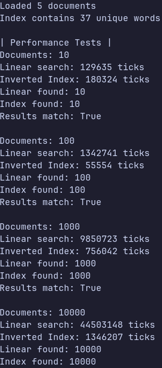
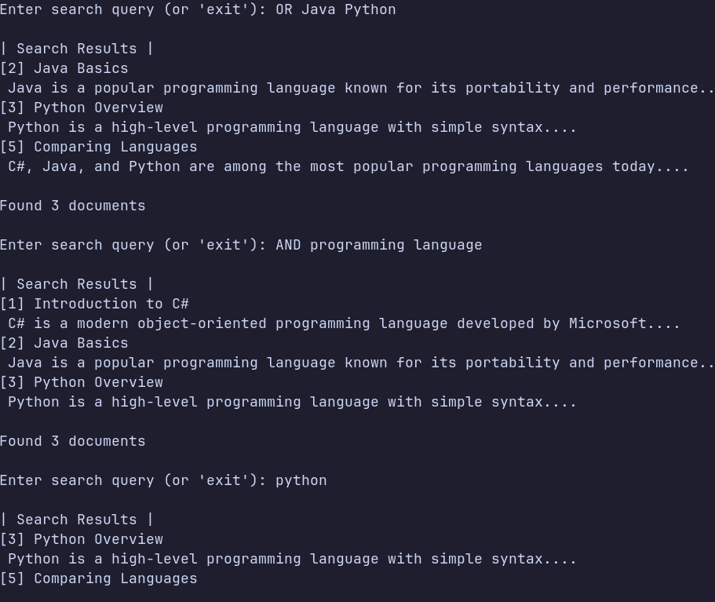

**Тема:** Колекції в практиці ООП: інвертований індекс і вимірювання продуктивності.

## Опис проєкту

Програма реалізує інвертований індекс для пошуку документів за ключовими словами.

Для роботи використано `Dictionary`, `HashSet` та `Stopwatch`.

## Інтерактивний пошук

Приклади запитів:

```
AND programming language
OR Java Python
python
exit
```

- `AND` — знаходить документи, які містять усі слова.
- `OR` — знаходить документи, які містять хоча б одне слово.
- Звичайне слово — виконує пошук за одним словом.
- `exit` — завершує програму.

## Результат




## Звіт

Детальніший опис реалізації, результати тестування та висновки наведені у файлі [REPORT.md](REPORT.md).
