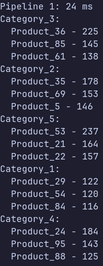
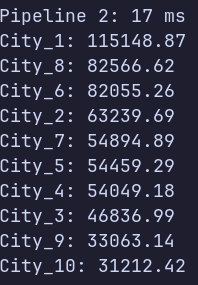
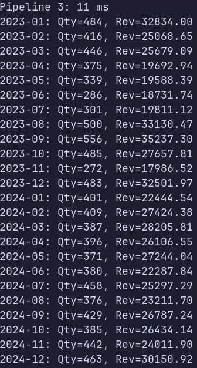
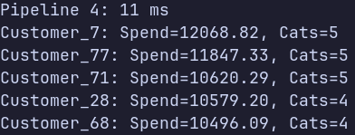

## Мета роботи
Розробити та проаналізувати складні LINQ-пайплайни для обробки даних, що імітують сценарії ETL (Extract, Transform, Load) та аналітики.

## Результати

## Результати виконання пайплайнів

### Пайплайн 1: Найпопулярніші продукти за категоріями
- **Час виконання:** ~24 ms
- **Опис:** Використано подвійне групування (`GroupBy`) та об'єднання (`Join`), щоб знайти топ-3 продукти за кількістю продажів у кожній категорії. Перший запит виконується трохи довше через витрати на JIT-компіляцію та ініціалізацію LINQ-механізмів.

### Пайплайн 2: Загальний дохід за містами клієнтів
- **Час виконання:** ~17 ms
- **Опис:** Здійснено `Join` трьох колекцій (Продажі, Продукти, Клієнти). Згруповано за містами (`GroupBy`) та відсортовано за спаданням загального доходу (`OrderByDescending`). Лідером стало `City_1` з доходом 115 148.87.

### Пайплайн 3: Продажі за місяцями та роками
- **Час виконання:** ~11 ms
- **Опис:** Створено проєкцію в анонімний тип для композитного ключа `new { Year, Month }`. Це дозволило згрупувати дані по місяцях і вивести часовий ряд продажів за 2023-2024 роки.

### Пайплайн 4: Топ-5 клієнтів за витратами (з умовою різноманітності)
- **Час виконання:** ~11 ms
- **Опис:** Складний аналітичний запит. Обчислює загальні витрати кожного клієнта, але враховує лише тих, хто купував товари щонайменше з 3 різних категорій (`Where`, `Distinct`, `Count`). Найцінніший клієнт — `Customer_7` (5 різних категорій, витрати 12 068.82).

## Висновки щодо ефективності LINQ
1. **Продуктивність:** LINQ to Objects демонструє високу ефективність для in-memory обробки даних. Усі складні агрегації та об'єднання на масиві з 1000 записів виконуються за лічені мілісекунди (11-24 мс).
2. **Читабельність та ETL:** Декларативний синтаксис методів розширення (`Select`, `Where`, `Join`) дозволяє описувати складні трансформації (Transform) даних компактно та зрозуміло.
3. **Проєкція:** Використання анонімних типів дозволяє "на льоту" формувати потрібну структуру даних, суттєво економлячи пам'ять під час проміжних обчислень.
