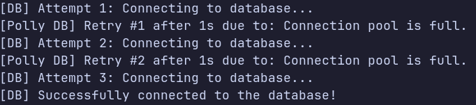
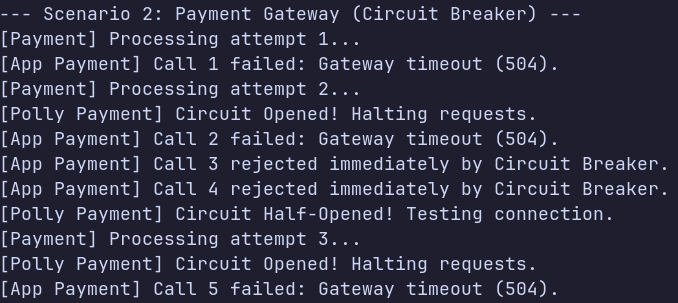
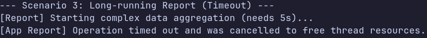
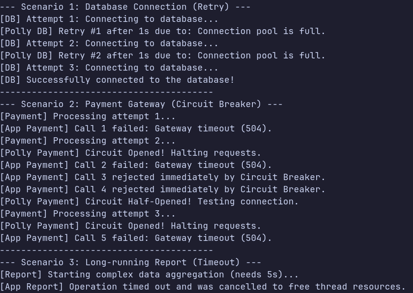

## Мета
Дослідити застосування Polly (Retry, Circuit Breaker, Timeout) у .NET через сучасне API `ResiliencePipelineBuilder`.

## Сценарій 1: Доступ до бази даних (Retry)
**Проблема:** БД тимчасово відхиляє підключення через переповнення пулу (Connection pool is full).
**Обґрунтування Retry:** Збій є короткочасним, тому 3 повторні спроби з паузою в 1с дозволяють успішно підключитися непомітно для користувача.

**Код:**
```csharp
var retryPipeline = new ResiliencePipelineBuilder().AddRetry(new RetryStrategyOptions {
    ShouldHandle = new PredicateBuilder().Handle<InvalidOperationException>(),
    MaxRetryAttempts = 3, Delay = TimeSpan.FromSeconds(1)
}).Build();
await retryPipeline.ExecuteAsync(async ct => await ConnectToDatabaseAsync(ct));
```
**Вивід:**


## Сценарій 2: Падіння платіжного шлюзу (Circuit Breaker)
**Проблема:** Сторонній платіжний сервіс не відповідає (Timeout 504).
**Обґрунтування Circuit Breaker:** `Retry` тут небезпечний (викличе перевантаження). "Запобіжник" після 2 помилок розриває ланцюг на 3с, миттєво відхиляючи нові запити, а потім частково відкривається (Half-Opened) для перевірки статусу сервісу.

**Код:**
```csharp
var cbPipeline = new ResiliencePipelineBuilder().AddCircuitBreaker(new CircuitBreakerStrategyOptions {
    ShouldHandle = new PredicateBuilder().Handle<Exception>(),
    FailureRatio = 0.5, MinimumThroughput = 2, BreakDuration = TimeSpan.FromSeconds(3)
}).Build();
await cbPipeline.ExecuteAsync(async ct => await ProcessPaymentAsync(ct));
```
**Вивід:**


## Сценарій 3: Зависання генерації звіту (Timeout)
**Проблема:** Агрегація даних зависає, блокуючи потік виконання нашого застосунку.
**Обґрунтування Timeout:** Жодна операція не має тривати вічно. Встановлюємо ліміт у 2с — якщо час вийшов, операція безпечно скасовується через `CancellationToken`.

**Код:**
```csharp
var timeoutPipeline = new ResiliencePipelineBuilder().AddTimeout(TimeSpan.FromSeconds(2)).Build();
try {
    await timeoutPipeline.ExecuteAsync(async ct => await Task.Delay(5000, ct)); 
} catch (TimeoutRejectedException) {
    Console.WriteLine("[App] Operation timed out and was cancelled.");
}
```
**Вивід:**


## Результат



## Висновки
1. **Чистий код:** Polly виносить логіку обробки збоїв за межі бізнес-методів.
2. **Захист ресурсів:** *Circuit Breaker* та *Timeout* запобігають каскадному падінню системи та вичерпанню пулу потоків.
3. **Гнучкість:** Завдяки `ResiliencePipelineBuilder` можна легко комбінувати кілька стратегій відмовостійкості в єдиний конвеєр.
