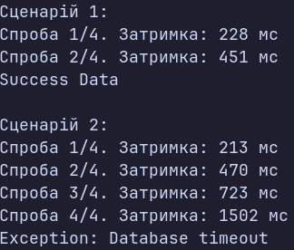

## Мета
Розробити власний допоміжний клас для реалізації патерну Retry з експоненційною затримкою та випадковим “jitter”.

## Результат виконання

## Висновки
1. **Згладжування навантаження:** Використання *Jitter* (випадкового відхилення) запобігає проблемі "Thundering Herd" — ситуації, коли після відновлення сервера всі клієнти одночасно повторюють свої запити і знову перевантажують його.
2. **Типи помилок:** Патерн ефективний лише для *транзієнтних* (короткочасних) збоїв, таких як таймаути мережі або тимчасова недоступність бази даних. Його недоцільно застосовувати для фатальних чи бізнес-помилок (наприклад, невірний пароль або відсутній файл), оскільки повторні спроби не змінять результат.
3. **Обмеження часу:** У системах реального часу (Real-time) експоненційна затримка може призвести до надмірного блокування потоків виконання. Для таких систем максимальну кількість спроб і базовий час затримки потрібно зводити до мінімуму.
