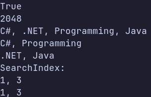

### Тема

Вивчення Dictionary<TKey, TValue> та HashSet<T> у бібліотеках .NET.

### Мета роботи

Дослідити використання узагальнених колекцій Dictionary та HashSet у .NET-бібліотеках і реалізувати приклади їх практичного застосування.

### Хід роботи

1. Створено консольний проєкт `DictionaryHashSetLab` на C# (.NET 8).
2. Досліджено використання Dictionary у проєкті .NET Runtime. Розглянуто метод ToDictionary для створення колекції пар ключ-значення.
3. Досліджено використання HashSet у .NET Runtime. Розглянуто метод ToHashSet для створення множини унікальних елементів.
4. Досліджено використання Dictionary та HashSet у проєкті AutoMapper для зберігання відповідностей типів та відстеження унікальних елементів.
5. Реалізовано клас `FileMetadataCache` з використанням Dictionary для зберігання метаданих файлів. Додано методи Add(), Get(), Remove() та Contains().
6. Реалізовано клас `TagManager` з використанням Dictionary та HashSet для зберігання тегів статей. Додано методи AddTag(), RemoveTag(), GetAllUniqueTags() та FindCommonTags().
7. У класі TagManager використано операції UnionWith(), IntersectWith() та ExceptWith().
8. Реалізовано клас `SearchIndex` з використанням Dictionary<string, HashSet<int>> для створення пошукового індексу документів.
9. Додано методи AddDocument(), Search() та SearchMultiple() для пошуку документів за одним або декількома словами.
10. Створено порівняльну таблицю складності операцій List, Dictionary та HashSet.
11. Перевірено роботу всіх трьох сценаріїв та отримано результати виконання в консолі.

### Результат

### Висновок

Під час самостійної роботи досліджено узагальнені колекції `Dictionary<TKey, TValue>` та `HashSet<T>` у .NET.
Реалізовано три практичні сценарії: кеш метаданих файлів, систему тегів для статей блогу та пошуковий індекс документів.
Встановлено, що Dictionary доцільно використовувати для зберігання пар ключ-значення та швидкого пошуку за ключем, а HashSet — для зберігання унікальних елементів і виконання операцій над множинами.
Закріплено навички роботи з узагальненими колекціями та їх практичного застосування в C#.
