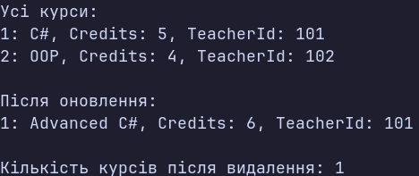
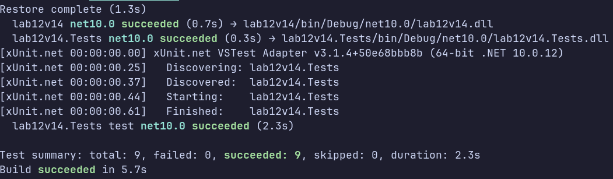

### Тема

Узагальнені типи (Generics). IRepository<T> з where-обмеженнями та тестами.

### Варіант

Course: Title, Credits, TeacherId

**Інтерфейс: IEntity**
- Властивість: Id (int).

**Узагальнений інтерфейс: IRepository<T>**
- Обмеження типу: where T : IEntity.
- Методи: GetById(int id), GetAll(), Add(T item), Update(T item), Delete(int id).

**Клас: InMemoryRepository<T>**
- Реалізує IRepository<T> та зберігає об'єкти в List<T>.
- Підтримує CRUD-операції.
- Використовує KeyNotFoundException для неіснуючих елементів та InvalidOperationException для дублікатів ID.

**Клас сутності: Course**
- Реалізує IEntity.
- Властивості: Id (int), Title (string), Credits (int), TeacherId (int).

### Хід роботи

1. Створено проєкти lab12v14 та lab12v14.Tests на основі xUnit і додано посилання на основний проєкт.
2. Реалізовано IEntity, IRepository<T> з обмеженням where T : IEntity та клас InMemoryRepository<T>.
3. Створено сутність Course із властивостями Id, Title, Credits і TeacherId.
4. У Main() продемонстровано додавання, отримання, оновлення та видалення курсів.
5. Передбачено обробку неіснуючих елементів і дублікатів ID.
6. Написано 9 юніт-тестів для перевірки CRUD-операцій і обробки помилкових ситуацій.
7. Перевірено роботу програми та успішне проходження всіх тестів.

### Результат

### Висновок

У ході лабораторної роботи розглянуто Generics та обмеження типів where. Реалізовано IEntity, IRepository<T>, InMemoryRepository<T> і сутність Course. Розглянуто CRUD-операції та використання xUnit для автоматизованого тестування роботи репозиторію.
