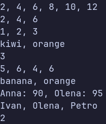

### Тема

Generic-методи для повторного використання компонентів: Mapper, Filter, Take, Skip, Count з використанням делегатів Func і Predicate.

### Варіант

14. `Map, Filter, Take, Skip, Count`

**Клас: `FunctionalUtils`**
- `Map<T, TResult>()` — перетворює елементи списку за допомогою `Func<T, TResult>`.
- `Filter<T>()` — повертає елементи, що задовольняють умову `Predicate<T>`.
- `Take<T>()` — повертає перші `n` елементів списку.
- `Skip<T>()` — пропускає перші `n` елементів списку та повертає решту.
- `Count<T>()` — підраховує кількість елементів, що задовольняють умову `Predicate<T>`.

**Клас: `Student`**
- Властивості: `Name` (string), `Grade` (int).
- Конструктор для ініціалізації імені студента та його оцінки.

### Хід роботи

1. Створено консольний проєкт `lab13v14` на основі .NET SDK.
2. Реалізовано статичний клас `FunctionalUtils` із п'ятьма generic-методами: `Map`, `Filter`, `Take`, `Skip` і `Count`.
3. Для передачі логіки обробки елементів використано делегат `Func<T, TResult>` та делегат `Predicate<T>`.
4. Створено клас `Student` для демонстрації роботи методів із власним типом даних.
5. У методі `Main()` створено тестові колекції типів `int`, `string` і `Student`.
6. За допомогою лямбда-виразів продемонстровано перетворення елементів, фільтрацію за умовою, отримання перших елементів, пропуск заданої кількості елементів і підрахунок елементів, що відповідають умові.
7. Перевірено роботу методів із різними типами даних та отримано очікувані результати в консолі.

### Результат

### Висновок

У ході лабораторної роботи розглянуто узагальнені методи та використання делегатів для повторного використання логіки обробки колекцій. Реалізовано методи `Map`, `Filter`, `Take`, `Skip` і `Count` у класі `FunctionalUtils`. Продемонстровано використання `Func<T, TResult>`, `Predicate<T>` і лямбда-виразів для роботи з різними типами даних, зокрема `int`, `string` і власним класом `Student`. Перевірено коректність виконання програми.
