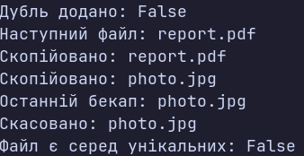

### Тема

`HashSet<T>`, `Queue<T>` і `Stack<T>`: практичні сценарії використання.

### Варіант

14. **Система резервного копіювання**
- `HashSet<string>` — зберігання унікальних файлів для бекапу.
- `Queue<string>` — черга файлів на копіювання.
- `Stack<string>` — історія бекапів для скасування останньої операції.

**Клас: `BackupSystem`**
- `AddFile()` — додає унікальний файл до набору та черги.
- `ContainsFile()` — перевіряє наявність файлу в наборі.
- `PeekNext()` — переглядає наступний файл у черзі.
- `ProcessNext()` — вилучає файл із черги та додає його до історії бекапів.
- `PeekLastBackup()` — переглядає останній бекап.
- `UndoLastBackup()` — скасовує останній бекап і видаляє файл із набору.

### Хід роботи

1. Створено консольний проєкт `lab14v14`.
2. Реалізовано клас `BackupSystem` для роботи з файлами резервного копіювання.
3. Для зберігання унікальних файлів використано `HashSet<string>`.
4. Для черги файлів на копіювання використано `Queue<string>`.
5. Для історії бекапів використано `Stack<string>`.
6. У методі `Main()` додано файли та продемонстровано відхилення дубліката.
7. Продемонстровано перегляд і обробку файлів у черзі, а також перегляд і скасування останнього бекапу.

### Результат

### Висновок

У ході лабораторної роботи реалізовано систему резервного копіювання з використанням `HashSet<string>`, `Queue<string>` і `Stack<string>`. Продемонстровано перевірку унікальності файлів, обробку черги за принципом FIFO та скасування останнього бекапу за принципом LIFO. Перевірено роботу програми в методі `Main()`.

