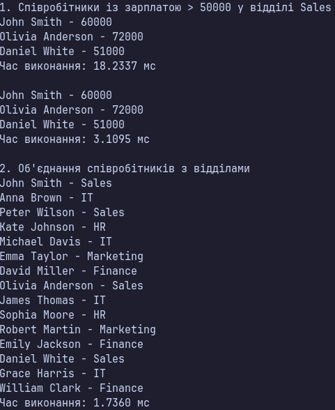
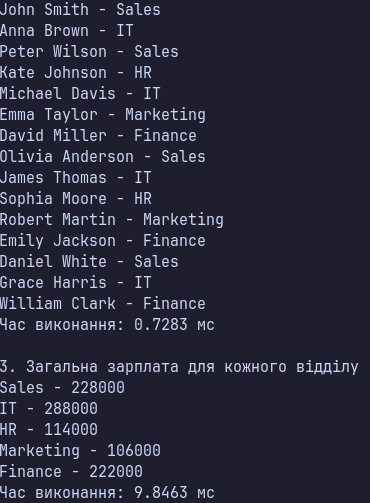
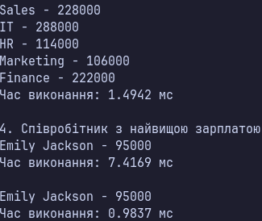

### Тема

LINQ в дії: фільтри, join, агрегації. Продуктивність.

### Варіант

14. **Управління співробітниками**
- `Employee` — зберігання інформації про співробітників (`Id`, `Name`, `DepartmentId`, `Salary`).
- `Department` — зберігання інформації про відділи (`Id`, `Name`, `Budget`).

**LINQ-запити:**
- Фільтрація співробітників із зарплатою понад 50000 у відділі `Sales`.
- `Join` — об'єднання співробітників із відповідними відділами.
- `GroupJoin`, `Sum` — підрахунок загальної зарплати для кожного відділу.
- `OrderByDescending`, `First` — пошук співробітника з найвищою зарплатою.

### Хід роботи

1. Створено консольний проєкт `lab15v14`.
2. Реалізовано класи `Employee` та `Department`.
3. Створено тестові колекції з 15 співробітників і 5 відділів.
4. Реалізовано чотири LINQ-запити у Query Syntax та Method Syntax.
5. Для об'єднання колекцій використано `Join` і `GroupJoin`.
6. Для агрегації зарплат використано `Sum`.
7. Для вимірювання часу виконання запитів використано `Stopwatch`.
8. Виведено результати запитів та час їх виконання в консоль.

### Результат

### Висновок

У ході лабораторної роботи реалізовано фільтрацію, об'єднання та агрегацію даних за допомогою LINQ. Продемонстровано роботу `Where`, `Join`, `GroupJoin`, `Sum` та інших операцій у двох синтаксисах: Query Syntax і Method Syntax. За допомогою `Stopwatch` виміряно час виконання запитів та порівняно їхню продуктивність. Перевірено правильність отриманих результатів.
