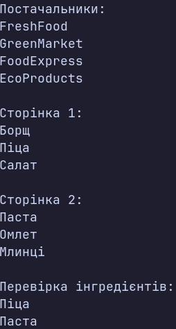

### Тема

LINQ: SelectMany, пагінація й custom extensions.

### Варіант

14. **Рецепти та їхні інгредієнти з постачальниками**
- `Recipe` — зберігання інформації про рецепти (`Id`, `Name`, `Ingredients`).
- `Ingredient` — зберігання інформації про інгредієнти (`Id`, `Name`, `Suppliers`).
- `Supplier` — зберігання інформації про постачальників (`Id`, `Name`).

**LINQ-запити:**
- `SelectMany`, `DistinctBy` — отримання всіх унікальних постачальників з усіх інгредієнтів усіх рецептів.
- `Skip`, `Take` — реалізація пагінації рецептів по 3 рецепти на сторінку.
- `HasIngredient(string ingredientName)` — власний метод розширення для перевірки наявності інгредієнта в рецепті.

### Хід роботи

1. Створено консольний проєкт `lab16v14`.
2. Реалізовано класи `Recipe`, `Ingredient` та `Supplier`.
3. Створено тестові колекції з 6 рецептів, 12 інгредієнтів та 4 постачальників.
4. Реалізовано LINQ-запит із використанням `SelectMany` для розгортання вкладених колекцій.
5. За допомогою `DistinctBy` отримано список унікальних постачальників.
6. Реалізовано пагінацію рецептів за допомогою `Skip` і `Take` по 3 рецепти на сторінку.
7. Створено власний метод розширення `HasIngredient()` для перевірки наявності певного інгредієнта в рецепті.
8. Продемонстровано роботу всіх реалізованих методів у `Main`.
9. Виведено результати запитів у консоль.

### Результат

### Висновок

У ході лабораторної роботи освоєно використання LINQ для роботи з вкладеними колекціями. За допомогою `SelectMany` виконано розгортання вкладених списків інгредієнтів і постачальників в одну послідовність, а `DistinctBy` дозволив отримати унікальних постачальників. Реалізовано пагінацію даних за допомогою `Skip` та `Take`. Також створено власний метод розширення `HasIngredient()` для перевірки наявності інгредієнта в рецепті. Перевірено правильність роботи всіх реалізованих функцій.
