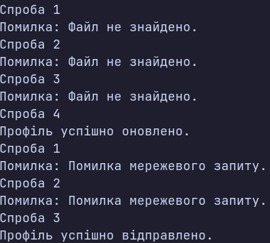

### Тема

Обробка IO/мережевих помилок та патерн Retry.

### Варіант

14. **Оновлення профілю користувача**
- `FileProcessor` — імітація `FileNotFoundException` перші 3 рази, потім успішне оновлення профілю у файлі.
- `NetworkClient` — імітація `HttpRequestException` перші 2 рази, потім успішне відправлення профілю.
- `RetryHelper` — узагальнений метод `ExecuteWithRetry<T>` для повторного виконання операцій.
- `shouldRetry` — повторення спроб лише для `FileNotFoundException` та `HttpRequestException`.
- Експоненційна затримка — подвоєння часу очікування після кожної невдалої спроби.

### Хід роботи

1. Створено консольний проєкт `lab17v14`.
2. Реалізовано клас `FileProcessor` для імітації помилок під час оновлення профілю користувача.
3. Створено клас `NetworkClient` для імітації тимчасових мережевих помилок.
4. Реалізовано узагальнений статичний клас `RetryHelper` з методом `ExecuteWithRetry<T>`.
5. Додано експоненційну затримку між спробами та логування помилок.
6. Реалізовано `shouldRetry` для вибіркового повторення операцій при `FileNotFoundException` та `HttpRequestException`.
7. У `Main` перевірено роботу обох сценаріїв: оновлення файлу після 3 невдалих спроб і мережеве відправлення після 2 невдалих спроб.

### Результат

### Висновок

Під час лабораторної роботи реалізовано обробку файлових і мережевих винятків та патерн Retry. Експоненційна затримка дозволяє збільшувати час очікування між повторними спробами, а `shouldRetry` визначає, для яких помилок їх потрібно виконувати. Перевірено успішну роботу обох сценаріїв.
