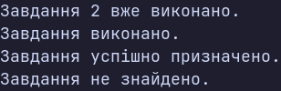

### Тема

Власні винятки та патерн Result.

### Варіант

14. **Управління задачами**
- `TaskAlreadyCompletedException` — власний виняток, який містить `TaskId` та виникає, якщо завдання вже виконано.
- `TaskService` — клас для управління завданнями.
- `CompleteTask(int taskId)` — виконує завдання або викидає власний виняток, якщо воно вже виконано.
- `AssignTask(int taskId, string assignee)` — повертає `Result<bool>` з результатом операції.
- `Result<T>` — узагальнений клас для зберігання результату операції або інформації про помилку.

### Хід роботи

1. Створено консольний проєкт `lab18v14`.
2. Реалізовано власний виняток `TaskAlreadyCompletedException` з властивістю `TaskId`.
3. Створено узагальнений клас `Result<T>` з властивостями `IsSuccess`, `Value`, `Error`.
4. Додано фабричні методи `Success()`, `Failure(string error)` та `Failure(Exception ex)`.
5. Реалізовано клас `TaskService` з методами `CompleteTask()` та `AssignTask()`.
6. У `Main` продемонстровано обробку власного винятку через `try-catch` та використання `Result<T>` для успішних і невдалих операцій.
7. Перевірено роботу програми та виведено результати виконання в консоль.

### Результат

### Висновок

Під час лабораторної роботи реалізовано власний виняток та узагальнений клас `Result<T>`. Винятки використовуються для обробки особливих помилок, а `Result<T>` — для очікуваних невдалих операцій. Перевірено роботу обох підходів на прикладі управління завданнями.
